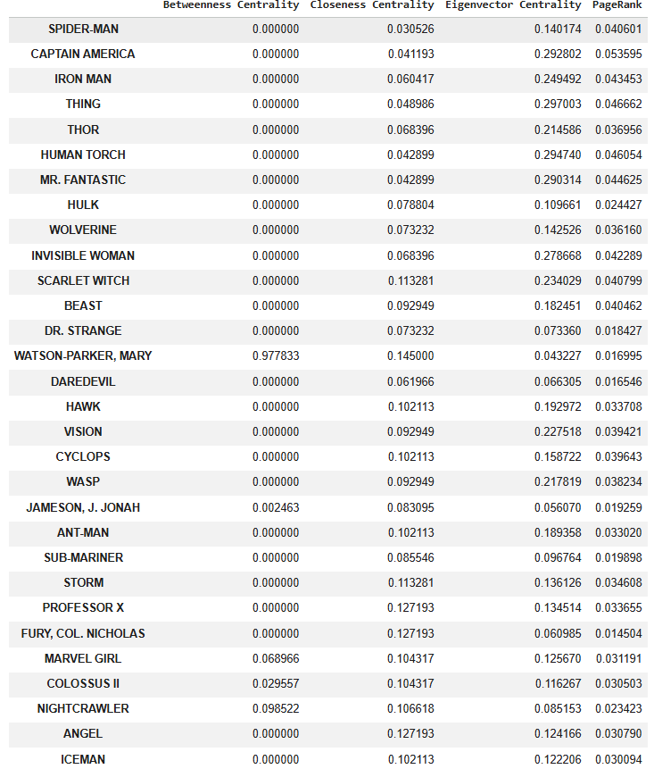
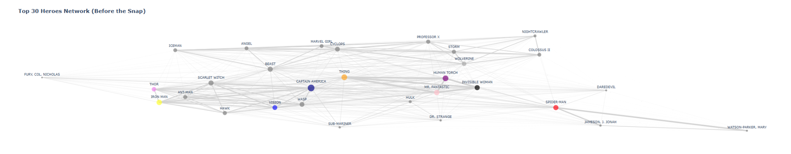
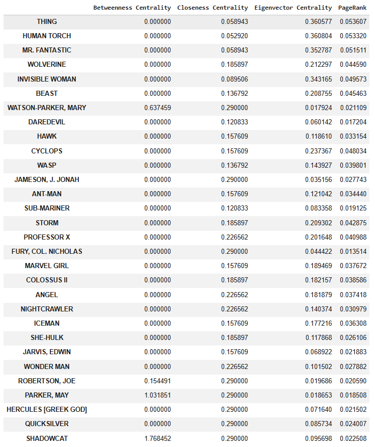
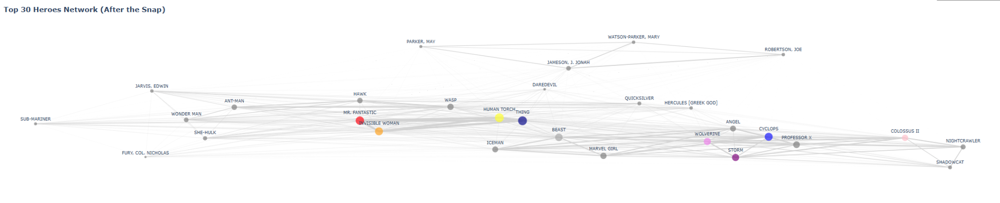
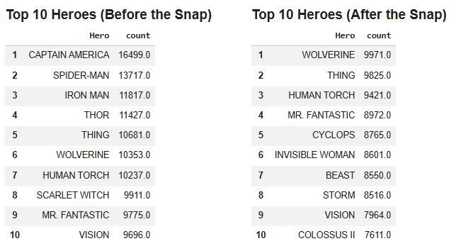
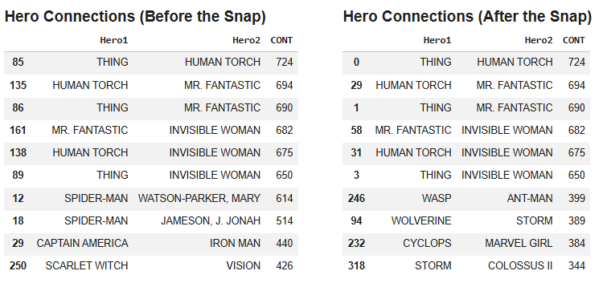

# Marvel Universe - Social Network Analysis

**Python · NetworkX · Pandas · NumPy · Matplotlib · Plotly · Graph Theory · Social Network Analysis**

## Project Overview

This project was developed as part of the **Network Optimization and Social Networks** course during my **Master's Degree in Data Analysis and Decision Support Systems**.

**Academic Grade: 18/20**

The objective was to explore the Marvel Universe through Social Network Analysis (SNA), using relationships between characters and comic book appearances to understand how the network is structured.

I also explored a fictional scenario inspired by **Thanos's Snap**, comparing the original network with a modified version where selected characters were removed.

This allowed me to examine how the disappearance of important characters affects the remaining connections, centrality measures, and overall network structure.

## Dataset

**Source:** [The Marvel Universe Social Network — Kaggle](https://www.kaggle.com/datasets/csanhueza/the-marvel-universe-social-network)

The dataset contains information about Marvel characters, comic books, and relationships between characters.

I used three CSV files:

- `nodes.csv` - Information about characters and comic book nodes.
- `edges.csv` - Connections between characters and comic books.
- `hero-network.csv` - Direct relationships between Marvel characters.

Using Python and NetworkX, I built graphs to represent these relationships and analyzed the most connected characters.

## Methodology

The project was divided into three main stages:

1. **Data Preparation:** Loading the datasets, exploring the relationships, and creating the network using NetworkX.
2. **Original Network Analysis:** Identifying important characters through centrality measures, connection counts, and network visualizations.
3. **Post-Snap Analysis:** Removing selected characters, rebuilding the network, and comparing the results with the original scenario.

---

## 1. Network Analysis - Before the Snap

I started by analyzing the original Marvel character network to identify the most connected characters and understand their importance within the graph.

### 1.1 Centrality Measures

To evaluate the importance of each character, I calculated several centrality measures:

- **Betweenness Centrality:** Measures how often a character appears on the shortest paths between other characters, helping identify potential bridges in the network.
- **Closeness Centrality:** Measures how close a character is to other reachable characters in the network.
- **Eigenvector Centrality:** Assigns greater importance to characters connected to other influential characters.
- **PageRank:** Evaluates the relative importance of nodes based on their connections.

These measures provide different perspectives on the importance of each character.



### 1.2 Network Visualization

I visualized the network containing the top 30 selected characters to better understand their relationships.



The graph shows a dense network of connections between several important Marvel characters.

Characters such as Captain America, Spider-Man, Iron Man, Thor, and members of the Fantastic Four appear within a highly interconnected structure.

This visualization helped me understand how relationships are distributed across the network and identify groups of closely connected characters.

---

## 2. Network Analysis - After the Snap

For the second part of the project, I simulated a fictional scenario inspired by Thanos's Snap.

I removed a selected group of characters from the original network and recalculated the network metrics.

The purpose was to understand how the removal of characters changes the importance and relationships of those who remain.

**Note:** This is a simulated scenario based on selected character removals, rather than an exact representation of Marvel's official storyline.

### 2.1 Centrality Measures After the Snap

After removing the selected characters, I recalculated the centrality measures to identify changes in the network.



The results show changes in the relative importance of several characters.

For example, Wolverine and members of the Fantastic Four remain prominent in the network, while some other characters gain importance following the removal of previously influential nodes.

Centrality values also change because the underlying graph has changed, meaning the results should be interpreted in the context of each network.

### 2.2 Network Visualization After the Snap

I then generated a new visualization using the remaining characters.



Comparing the two graphs makes it possible to observe how the network changes after removing selected characters.

Some relationships disappear, while the remaining characters continue to form connected groups.

The comparison illustrates how the structure of a social network depends on the nodes that belong to it.

---

## 3. Comparing the Two Scenarios

After analyzing both networks individually, I compared the results to understand which characters became more prominent and which relationships remained important.

### 3.1 Top 10 Most Connected Characters

I compared the ten characters with the highest connection counts before and after the Snap.



**Before the Snap:**

Captain America had the highest connection count, with 16,499, followed by Spider-Man with 13,717 and Iron Man with 11,817.

Other prominent characters included Thor, Thing, Wolverine, and Human Torch.

**After the Snap:**

Wolverine became the most connected character in the remaining network, with 9,971 connections.

Thing followed with 9,825, and Human Torch with 9,421.

The results show how removing characters changes the ranking of the most connected nodes.

It is important to distinguish between becoming more highly ranked and gaining new connections: a character can move up the ranking simply because other influential characters have been removed.

### 3.2 Strongest Character Connections

I also analyzed the most frequent connections between pairs of Marvel characters.



One of the most interesting findings was the strength of the relationships between members of the Fantastic Four.

For example:

| Character 1 | Character 2 | Connections |
|---|---|---:|
| Thing | Human Torch | 724 |
| Human Torch | Mr. Fantastic | 694 |
| Thing | Mr. Fantastic | 690 |
| Mr. Fantastic | Invisible Woman | 682 |
| Human Torch | Invisible Woman | 675 |
| Thing | Invisible Woman | 650 |

These six relationships remained among the strongest connections after the simulated Snap.

This suggests that the Fantastic Four form a particularly interconnected group within the dataset.

The analysis also showed how certain connections disappeared from the top rankings following the removal of characters such as Spider-Man and Captain America.

---

## 4. Key Findings

The comparison between the original and modified Marvel networks highlighted several observations.

**Network importance is not determined by connection count alone.**

Centrality measures provide additional information about a character's position and influence within the network.

**Removing influential characters changes the network structure.**

Following the simulated Snap, the ranking of the most connected characters changed significantly, with Wolverine becoming the highest-ranked remaining character.

**Strongly connected groups can remain prominent.**

The Fantastic Four maintained several of the strongest relationships in the network, demonstrating the importance of closely connected groups.

**Network analysis can be used to study structural changes.**

Although this project uses fictional characters, the same concepts can be applied to real-world networks, including social relationships, communication networks, and organizational structures.

## 5. Technologies Used

| Technology | Purpose |
|---|---|
| Python | Data processing and analysis |
| Pandas | Data manipulation and preparation |
| NumPy | Numerical operations |
| NetworkX | Graph creation and network metrics |
| Matplotlib | Data visualization |
| Plotly | Interactive visualizations |
| Jupyter Notebook / Google Colab | Development environment |

## 6. Repository Structure

```text
Marvel_Network/
├── README.md
├── data/
│   ├── edges.csv
│   ├── hero-network.csv
│   └── nodes.csv
├── notebooks/
│   └── Marvel_Network_English_Portfolio.ipynb
└── images/
    ├── centrality_before_snap.png
    ├── network_before_snap.png
    ├── centrality_after_snap.png
    ├── network_after_snap.png
    ├── top10_heroes_comparison.png
    └── hero_connections_comparison.png
```

## 7. Academic Context

This project was completed during my Master's Degree in **Data Analysis and Decision Support Systems**, as part of the Network Optimization and Social Networks course.

**Final Grade: 18/20**

It gave me practical experience working with graph-based datasets, network visualization, centrality algorithms, and comparative analysis.

The project also helped me develop a better understanding of how graph theory can be applied to identify relationships, influential nodes, and structural changes in complex networks.

---
